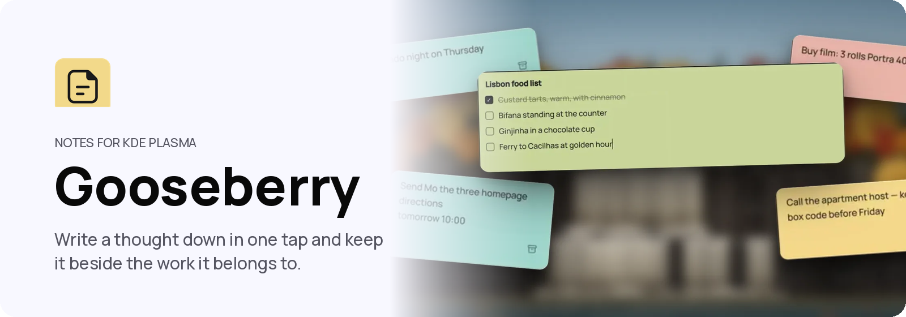

<p align="center">
  <picture>
    <source media="(prefers-color-scheme: dark)" srcset="assets/readme/banner-dark.png">
    
  </picture>
</p>

<p align="center">
  
  
  
  
</p>

<p align="center">
  <a href="#install">Install</a> · <a href="#controls">Controls</a> · <a href="docs/README.md">Docs</a> · <a href="#used-in-shuffle">Used in Shuffle</a>
</p>

<p align="center">
Notes, stickies and a planner for a touchscreen Linux desktop. Write a thought
down in one tap, keep it beside the work it belongs to, or put it on the
planner when it has a time. Nothing asks for a title, a folder or a save first.
</p>


https://github.com/user-attachments/assets/492e9fef-372f-434d-ab93-b7b324e6898b


## What you get

<table>
<tr>
<td width="33%" valign="top"><b>Capture</b><br>New note opens a page with the cursor already in it. It is saved as you type, from the first letter.</td>
<td width="33%" valign="top"><b>Folders</b><br>Each note is kept in a folder, Inbox unless you choose. Start a folder before any work exists, or give one to a workspace.</td>
<td width="33%" valign="top"><b>Stuck to the work</b><br>A note can be stuck to a window. Its notes come up over it to type on, move, resize or copy from, and fold into a small dot when you go back to the window.</td>
</tr>
<tr>
<td width="33%" valign="top"><b>Planner</b><br>A note with a time goes on the planner and reminds you. Everything else is an idea, and waits without a date.</td>
<td width="33%" valign="top"><b>Find</b><br>A note turns up when you search the board, or Search where Tettegouche is installed.</td>
<td width="33%" valign="top"><b>Never lost</b><br>Nothing asks for a title or a folder first. A removed note goes to the desktop's trash, and Undo brings it back.</td>
</tr>
</table>

Capture, the board, the planner, folders, notes stuck to windows and notes in
Search are all built. The idea behind it is in [docs/CONCEPT.md](docs/CONCEPT.md).

<details>
<summary>What it never does</summary>

- Ask for a title or a folder before a note is kept.
- Lose a note. A note you remove goes to the desktop's trash first.
- Take up room you did not ask it to.

</details>

## Controls

| Task | Touch | Keyboard |
| --- | --- | --- |
| Capture a note | Hold Gooseberry, then tap New note | None yet |
| Finish a note | Tap the work around the card | `Esc` |
| Open the board | Tap Gooseberry, or hold it and tap All notes | None yet |
| Set a reminder | Tap Remind | None yet |
| Bring up a window's notes | Tap the dot in its title bar | None yet |
| Copy words from a note | Hold a word | `Ctrl+C` |

Every tap and key, and what happens, is in [docs/INPUT.md](docs/INPUT.md).

## Install

These steps are for Arch Linux or CachyOS running KDE Plasma 6.4 or newer.
Gooseberry is built on your computer from this page's code, so you type a few
commands into **Konsole**, Plasma's terminal. Open it from the application
launcher.

### 1. What you need

Check your Plasma version. It must say 6.4 or higher:

```bash
plasmashell --version
```

Bring the computer up to date. If you just did this for another part of the
suite, skip it:

```bash
sudo pacman -Syu
```

Restart the computer only if that update installed a new `kwin`,
`plasma-workspace` or kernel (`linux`, or `linux-cachyos` on CachyOS): Gooseberry is built against what is
installed, so that has to be what is running.

Then install what the build needs. Type your password when asked, and answer
`Y`:

```bash
sudo pacman -S --needed base-devel git cmake extra-cmake-modules python dbus qt6-base qt6-declarative kcoreaddons kdbusaddons ki18n kservice kwindowsystem kirigami layer-shell-qt plasma-workspace
```

If pacman says a package **is up to date -- skipping**, or **there is nothing
to do**, that is normal: it is already installed.

### 2. Download

This puts the code in a folder called `gooseberry` in your home folder. Use
`git`, not GitHub's Download ZIP: the installer's checks read the download's
history.

```bash
cd ~
git clone https://github.com/carlsonjm/gooseberry.git
cd gooseberry
```

### 3. Install

```bash
./install.sh
```

The installer checks the code, builds it and runs every test. Then it asks for your password in Konsole (nothing shows as you
type) to install Gooseberry for every account on the computer. It ends with
**Gooseberry installed**.

### 4. Finish

There is nothing to turn on. Gooseberry is in the application launcher now,
and from your next sign-in it starts by itself, out of sight.

### 5. Check it worked

1. Open the application launcher, type **Gooseberry** and open it. The board
   of notes opens.
2. Tap **New note** and type a line. It is kept as you type; there is no save.
3. Open **Documents** in Dolphin: a `Gooseberry` folder holds the note as a
   Markdown file.

### 6. Update

To get a newer Gooseberry:

```bash
cd ~/gooseberry
git pull
./install.sh
```

### 7. Uninstall

```bash
cd ~/gooseberry
./uninstall.sh
```

It asks for your password and ends with **Gooseberry removed**. A Gooseberry
already running keeps running until you sign out. Your notes stay in
Documents › Gooseberry; delete that folder yourself if you want them gone. To
delete the download too, run `rm -rf ~/gooseberry`.

<details>
<summary>With cards and Search</summary>

Gooseberry works on any KDE Plasma desktop. Where the Kadunce card workspace is
running, the quick note opened in Spread takes its centre, and each card shows
its window's notes where they stand. Where Tettegouche's Search is
installed, notes are found there too, and Search can host the quick note
itself. Where the title bar draws Gooseberry's dot, as Shuffle's does, a window
with notes shows one. What each adds, and what it needs, is in
[docs/DESKTOP.md](docs/DESKTOP.md). Inside Shuffle, Gooseberry is called Notes;
its notes folder keeps the name `Gooseberry`.

</details>

## For developers

<details>
<summary>Working in this repository</summary>

Read [AGENTS.md](AGENTS.md) before working here. The documentation index is
[docs/README.md](docs/README.md). Run `./verify.sh` before proposing a change:
it checks public text and that every on-screen word can be translated, builds,
and runs the tests.

| Folder | What is in it |
| --- | --- |
| `src/` | The program: `core` keeps notes, `desktop` talks to the desktop, `app` starts it |
| `qml/` | The quick-note card, the board, the planner and stuck notes |
| `data/` | The launcher entry, autostart entry, bus service and icon |
| `tests/` | The automated checks |
| `tools/` | Keeps every on-screen word translatable |

</details>

## Used in Shuffle

[Shuffle](https://shuffleplasma.com), a touch-first desktop built on KDE
Plasma, includes Gooseberry as its Notes. Its other open-source components are
[Kadunce](https://github.com/carlsonjm/kadunce),
[Tettegouche](https://github.com/carlsonjm/tettegouche),
[Temperance](https://github.com/carlsonjm/temperance),
[Shuffle Keyboard](https://github.com/carlsonjm/shuffle-keyboard) and
[Split Rock](https://github.com/carlsonjm/split-rock).

## License

Gooseberry is licensed under GPL-2.0-or-later. See [LICENSE](LICENSE).

The project names and marks are not covered by that licence. See
[TRADEMARKS.md](TRADEMARKS.md).

<p align="center"><picture><source media="(prefers-color-scheme: dark)" srcset="assets/readme/good-input-white.png"></picture></p>
